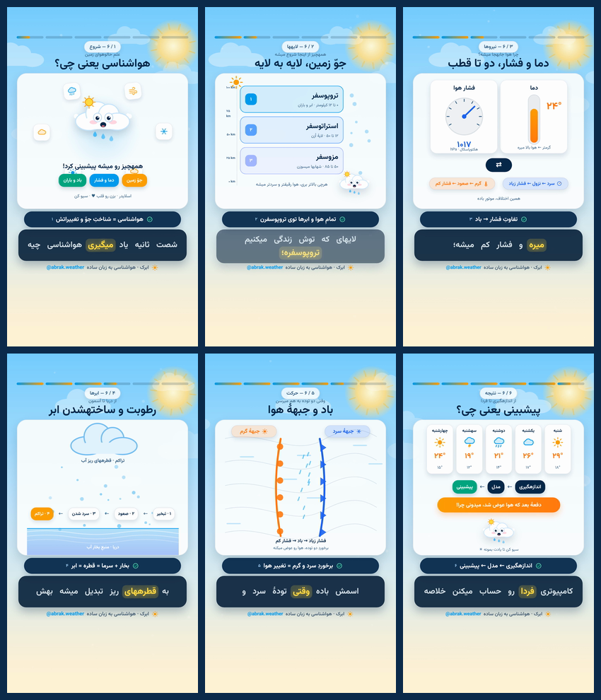

# ابرک — هواشناسی در ۶۰ ثانیه ☁️

یک ریلز آموزشی فارسی دربارهٔ **هواشناسی**، ساختهشده با **[Remotion](https://github.com/remotion-dev/remotion)** (همون پروژهای که معرفی کردی) و تدوین نهایی با **FFmpeg**.



## خروجیها

| فایل | ابعاد | کاربرد |
| --- | --- | --- |
| `rendered/weather-reels-1080x1920.mp4` | **1080×1920 (9:16)** | **اصلی — ریلز و استوری اینستاگرام** |
| `rendered/weather-feed-1080x1350.mp4` | 1080×1350 (4:5) | پست فید عمودی |
| `rendered/weather-feed-1080x1080.mp4` | 1080×1080 (1:1) | پست فید مربعی |
| `rendered/weather-reels-720x1280.mp4` | 720×1280 | نسخهٔ سبک برای آپلود سریع |
| `rendered/preview.gif` | 300px | پیشنمایش سریع |
| `rendered/weather.srt` | — | زیرنویس فارسی |
| `rendered/qa.json` | — | گزارش کامل کیفیت |

همهٔ نسخهها **۶۰٫۰۰ ثانیه، ۳۰ فریم، ۱۸۰۰ فریم، H.264/yuv420p + AAC 48kHz استریو** هستن. نسخههای فید با پسزمینهای تارشده (blurred letterbox) ساخته شدن تا هیچ متنی بریده نشه.

## مشخصات فنی

- 🎬 **رندر:** Remotion 4.0.539 — کامپوننتهای React، frame-driven و کاملاً تعیینپذیر (هیچ `Math.random()`، هیچ API خارجی لحظهای).
- 🗣 **صدا:** شش کلیپ `edge-tts` با صدای `fa-IR-DilaraNeural` و `pitch=+12Hz`. MP3ها و `WordBoundary`ها کامیت شدن، پس **CI کاملاً آفلاینه**.
- 🔤 **زیرنویس:** کارائوکه RTL مستقیم توی React (فونت Vazirmatn محلی، `direction: rtl`) + ترک نرم `mov_text` با `language=fas`. کلمات دقیقاً روی زمان TTS هایلایت میشن و همون تایمینگها دهان شخصیت «ابرک» رو تکون میدن.
- 🎵 **موسیقی:** سنتز numpy — Gmaj7–Em7–Cmaj7–D6 + پالس نرم + آرپژ زنگولهای. بدون سمپل، بدون لایسنس، بدون دانلود.
- 🎚 **تدوین:** `sidechaincompress` برای داکینگ موسیقی زیر صدا، `amix`، `loudnorm` هدف −۱۴ LUFS با true peak −۱٫۷ dBTP، فید ورود/خروج، trim دقیق ۶۰ ثانیه، و `h264_metadata` برای تگ رنگ BT.709.
- ✅ **QA:** طول، ابعاد، فریم، کدکها، زیرنویس، بلندی صدا، ابعاد سه نسخهٔ تحویلی و `ffmpeg-skill check.py --platform reels`.

آخرین QA محلی:

```
PASS duration 60.011 | 1080x1920 | 30/1 | 1800 frames | h264/yuv420p | aac 48000
PASS soft RTL subtitle ['fas']
PASS integrated loudness -14.85 LUFS   PASS true peak -1.67 dBTP
ffmpeg-skill: ok True | failed 0 | warnings 0
```

## چرا Remotion؟ (و یه نکتهٔ حقوقی)

| گزینه | نتیجه |
| --- | --- |
| **Remotion** ✅ | همون چیزی که خواستی. React + frame number = رندر تعیینپذیر، RTL عالی توی Chrome، فونت محلی، خروجی MP4 مستقیم، مناسب CI. |
| Manim | قبلاً باهاش دو ریپو ساختم؛ برای ریاضی عالیه، ولی اینجا خواستی Remotion. |
| HyperFrames | HTML/CSS timeline، ولی Node 22 + Chromium اضافه میخواد. |
| Rive / Lottie | برای کاراکتر خوبن، ولی تدوین و صدا رو جدا میخوان. |

⚠️ **لایسنس Remotion:** برای **اشخاص حقیقی، تیمهای تا ۳ نفر، و نهادهای غیرانتفاعی رایگانه** — حتی استفادهٔ تجاری. سازمانهای بزرگتر به لایسنس پولی نیاز دارن. چون این ریپو متعلق به یک اکانت شخصیه، `remotion.config.ts` صریحاً `Config.setPublicLicenseKey('free-license')` گذاشته. جزئیات: [remotion.dev/docs/license/faq](https://www.remotion.dev/docs/license/faq).

## ساختار

```
src/storyboard.json   ← تکمنبع حقیقت: ۶ صحنه، متن گویندگی، رنگها، پیشبینی ۵ روزه
src/components/       ← SkyBackground, Abrak (شخصیت ابر), icons, Chrome, ۶ صحنه
captions/             ← words / lines / visemes / fa.srt (همه کامیت شده)
public/audio/         ← voice_*.mp3 + final-mix.wav (کامیت شده → CI آفلاین)
public/fonts/         ← Vazirmatn Regular/Bold (کامیت شده)
tools/                ← build_voice, build_music, mix_audio, render, edit, qa
.github/workflows/    ← رندر کامل داخل GitHub Actions
```

## اجرا

```bash
bash scripts/setup_local.sh     # ffmpeg + libs + npm ci + pip + Chrome Headless Shell
make preview                    # ۱۰ ثانیه، مقیاس ۴۰٪ — چک سریع
make render                     # رندر کامل 1080×1920 + تدوین + QA
make studio                     # پیشنمایش زندهٔ Remotion
make typecheck                  # tsc --noEmit
```

داخل GitHub Actions هم دقیقاً همین `python3 tools/render.py` اجرا میشه؛ بعد آرتیفکت آپلود و خروجیها به `rendered/` کامیت میشن.

## تغییر محتوا (برای ایجنتها)

`src/storyboard.json` رو ویرایش کن، بعد:

```bash
python3 tools/build_voice.py     # فقط وقتی متن گویندگی عوض شده (نیاز به اینترنت)
python3 tools/build_music.py
python3 tools/mix_audio.py
python3 tools/render.py
```

برای جزئیات بیشتر: [`AGENTS.md`](AGENTS.md)، [`SKILL.md`](SKILL.md)، [`docs/ARCHITECTURE.md`](docs/ARCHITECTURE.md)، [`docs/TOOL_CHOICE.md`](docs/TOOL_CHOICE.md).

## مناطق امن اینستاگرام

همهٔ متنها داخل محدودهٔ امن طراحی شدن (بر اساس `ffmpeg-skill` reels spec): بالا ۸٪، پایین ۲۰٪، چپ ۵٪، راست ۱۲٪. کپشنها کاملاً بالای نوار UI پایین قرار دارن و نوار پیشرفت زیر نوار بالای اپ نمیره.

---

ساختهشده با ❤️ و `npx remotion render`. لایسنس کد: MIT. صداها: Microsoft Edge neural TTS. فونت: [Vazirmatn](https://github.com/rastikerdar/vazirmatn) (SIL OFL).
